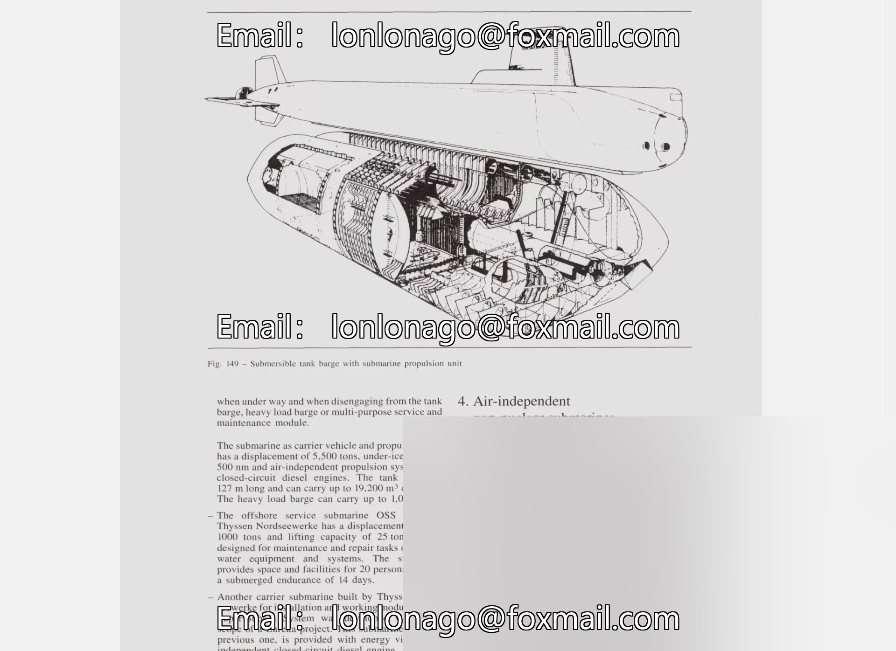
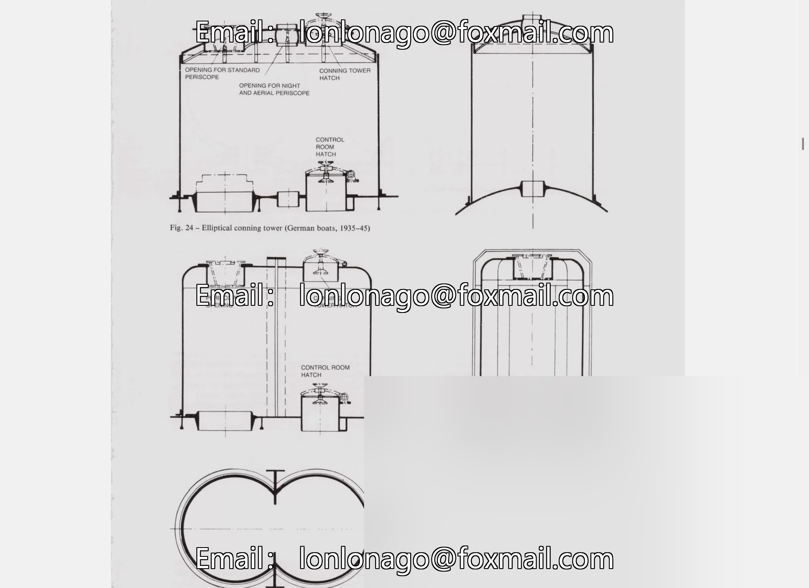
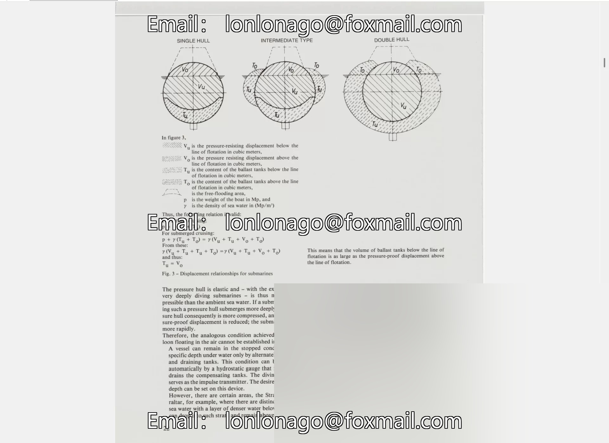
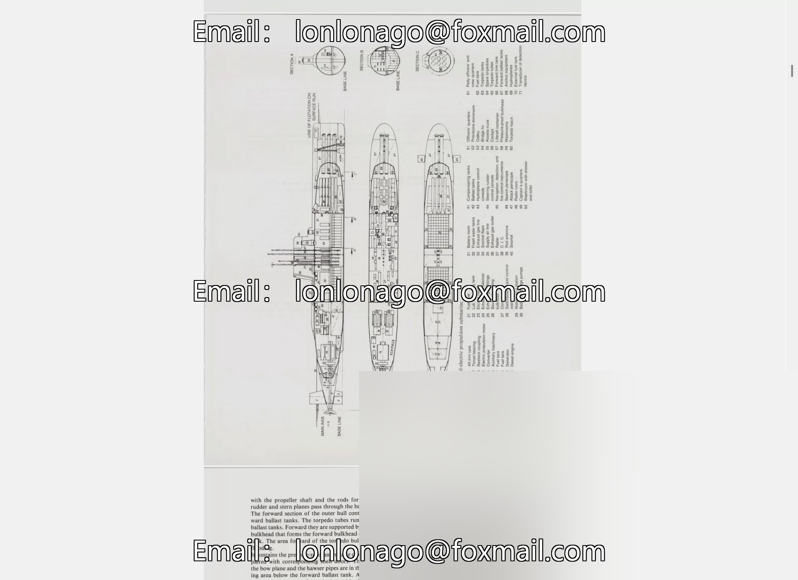

# "The Submarine Design" (Fritz Abels & Jürgen Ri)

## Body

"Design of Submarines" (Revised Edition by Fritz Abels & Jürgen Ritterhoff)
186 pages, , PDF format.
The content covers submarine structures, system layouts, design principles, etc., with detailed drawings and explanations.
The materials are authoritative, suitable for reference by enthusiasts in military, shipbuilding engineering, and historical materials.
can be copied, and they are non-refundable upon sale.

The material covers submarine design, structure, system layout, design principles, detailed drawings and instructions; it is in 186-page PDF format, sourced from an authoritative source and suitable for military, ship engineering or historical reference users.

<!-- AI_ENRICHED -->

## Images

## Payment

Here is a pay link on Stripe ( https://buy.stripe.com/3cs8yP7sY87d0vu9AB ). Please contact me lonlonago@foxmail.com after funding $89, and I will send you a complete data files , thank you!

